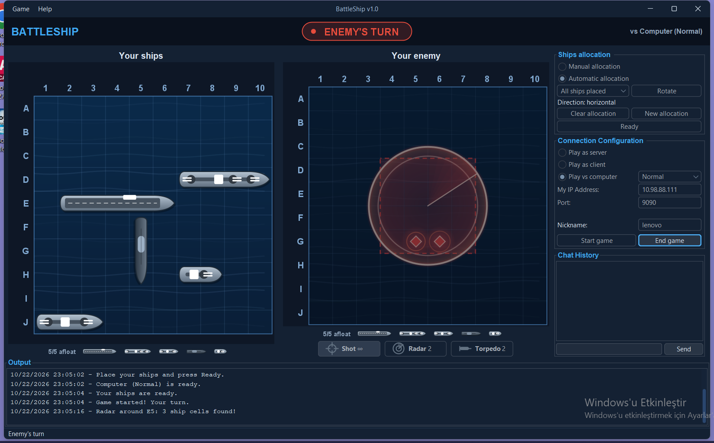
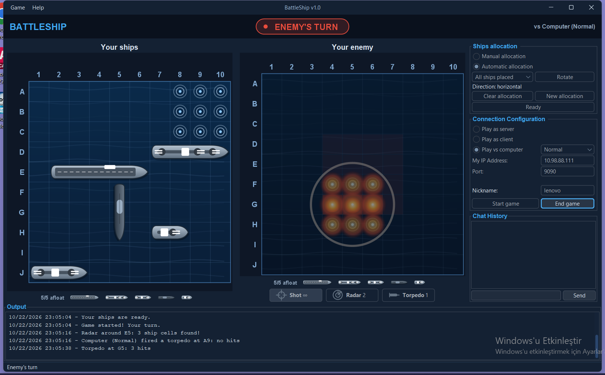

# BattleShip v1.0 (Amiral Battı)


Amiral Battı oyunu: ağ üzerinden (TCP) iki kişi veya bilgisayara karşı. Java 17 + Swing (FlatLaf koyu tema) arayüz, SQLite veritabanı.


* **Ağ üzerinden insan–insan**: sunucu / istemci, satır tabanlı metin protokolü ([docs/PROTOCOL.md](docs/PROTOCOL.md))
* **Bilgisayara karşı**: Easy / Normal / Hard (olasılık haritası kullanan yapay zekâ)
* **Radar** (3 hak, 4×4 tarama) ve **torpido** (2 hak, 3×3 saldırı), yalnızca kendi sıranda
* Çizilmiş gemiler, animasyonlu deniz, atış ve torpido efektleri, Oracle Lens tarzı radar dalgası
* Manuel veya otomatik gemi yerleşimi, sohbet, olay günlüğü
* Oyunlar, hamleler, yerleşimler, sohbet ve loglar SQLite'ta saklanır; geçmiş ve kazanma istatistikleri arayüzde gösterilir ([docs/DATABASE.md](docs/DATABASE.md))

## Gereksinimler

* JDK 17 veya üzeri
* Maven gerekmez: repodaki Maven Wrapper (`mvnw` / `mvnw.cmd`) ilk çalıştırmada Maven 3.9.9'u indirir.

## Derleme ve test

```
./mvnw -B verify          # Linux / macOS / Git Bash
mvnw.cmd -B verify        # Windows cmd / PowerShell
```

Birim + entegrasyon testlerini çalıştırır; kapsam raporu: `target/site/jacoco/index.html`.

## Çalıştırma

```
./mvnw -B package -DskipTests
java -jar target/battleship.jar
```

veya jar üretmeden: `./mvnw -q compile exec:java`.

İsteğe bağlı argüman: veritabanı adresi (varsayılan `jdbc:sqlite:data/amiral.db`). Aynı bilgisayarda ikinci pencere için:

```
java -jar target/battleship.jar jdbc:sqlite:data/client.db
```

Hızlı deneme:

* **Bilgisayara karşı:** `Play vs computer` → zorluk seç → `Start game` → `Ready`.
* **İki kişi:** birinci pencerede `Start server`, ikincide `Play as client` → `Connect` (127.0.0.1:9090), iki tarafta `Ready`.

Oyun sırasında düşman tahtasının altından silah seçin (`1` atış, `2` radar, `3` torpido) ve hücreye tıklayın.

| Radar | Torpido |
|---|---|
|  |  |

## Proje yapısı

| Paket | Sorumluluk |
|---|---|
| `com.amiral.model` | Saf Java oyun kuralları: `Coordinate`, `Ship`, `Board`, `Weapon`, `GameEngine`, `RandomFleetGenerator`, `ComputerPlayer` (yapay zekâ) |
| `com.amiral.net` | Protokol ve soketler: `ProtocolCodec`, `Connection` (kalp atışı), `GameServer`, `GameClient` |
| `com.amiral.db` | JDBC + SQL: `Database`, repository sınıfları, `StatsRepository` |
| `com.amiral.controller` | Model + ağ + DB + UI köprüsü: `GameController`, `AppEvent`, `ComputerGateway` (bilgisayar rakip) |
| `com.amiral.ui` | Swing arayüz: `MainFrame`, `BoardPanel` (çizim ve animasyon), `ShipPainter`, `WeaponPanel`, paneller, `HistoryDialog` |

## Dokümanlar

* [Kullanım kılavuzu](docs/USER_MANUAL.md)
* [Ağ protokolü](docs/PROTOCOL.md)
* [Veritabanı](docs/DATABASE.md)
* [Test planı](docs/TEST_PLAN.md)
* Test case dokümanları: [TC-01 Ağ üzerinden oyun](docs/test-cases/TC-01-ag-uzerinden-oyun.md), [TC-02 Bilgisayara karşı oyun](docs/test-cases/TC-02-bilgisayara-karsi-oyun.md), [TC-03 Radar ve torpido](docs/test-cases/TC-03-radar-ve-torpido.md)
* [Ödev isterleri](docs/odev-isterleri.png)
* [Rapor](docs/REPORT.md)
* [UML diyagramları](docs/diagrams/) (PlantUML)
* [Yol haritası](ROADMAP.md)
